# GlassyTube

YouTube playback, search, link sharing, and a LAN remote for Google Glass.

GlassyTube is an extended build of the original [CatotheCat11/GlassTube](https://github.com/CatotheCat11/GlassTube) project. The original project established the core Google Glass YouTube client: Glass voice search, card-based results, YouTube link handling, and ExoPlayer playback. GlassyTube keeps that foundation and adds a stability-first XE24 workflow, a phone-friendly remote, live-stream audio fixes, queue/history/favorites, and battery-conscious service behavior.

## Attribution

Original project:

- **GlassTube** by **CatotheCat11**
- Upstream repository: [github.com/CatotheCat11/GlassTube](https://github.com/CatotheCat11/GlassTube)
- Original core behavior: Google Glass YouTube search, result cards, link intents, and in-Glass playback

Extended work in this fork:

- Google Glass Explorer Edition / XE24 compatibility testing
- Remote-control PWA served from Glass on port `8765`
- iOS/phone link sending and queueing
- Improved live-stream audio handling
- Playback status tracking and timeline scrubbing support
- Local history, favorites, and queue support
- Battery and service lifecycle hardening
- GlassyTube Remote module for waking and controlling GlassyTube

If you reuse this project, keep the upstream attribution intact.

## Project Status

This is a personal/testing-oriented extended build for old Google Glass hardware. It has been tested against Google Glass Explorer Edition on XE24 / Android 4.4.4 with ADB access.

It is not an official YouTube, Google Cast, Google Glass, or OpenAI product.

## Screenshots

### On-Glass UI

Current on-device screenshots from GlassyTube running on Glass XE24:

| Home | Voice status | Queue |
| --- | --- | --- |
| 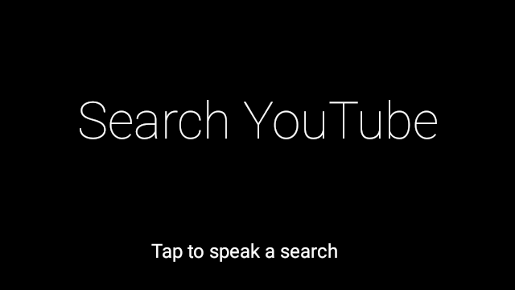 | 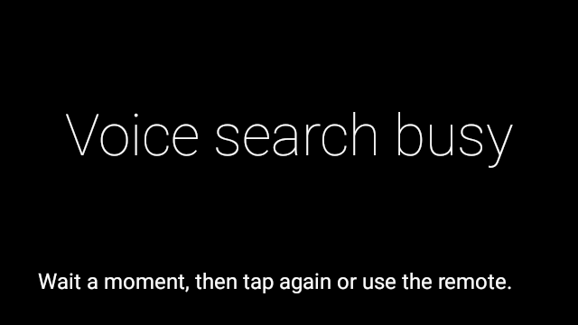 | 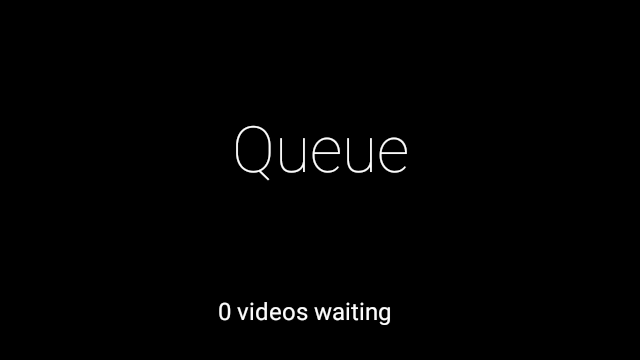 |

| Recent | Favorites | Send setup |
| --- | --- | --- |
| 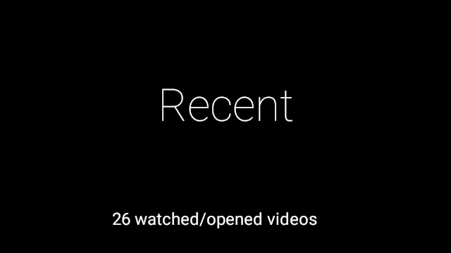 | 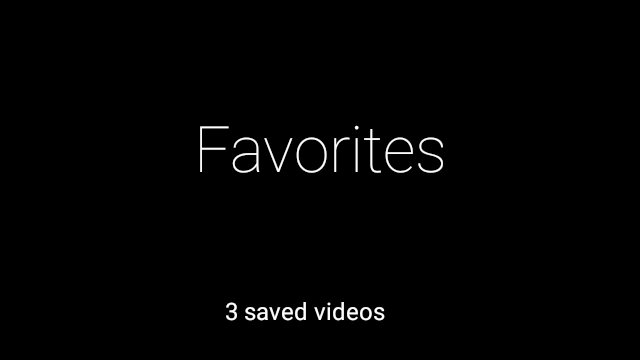 | 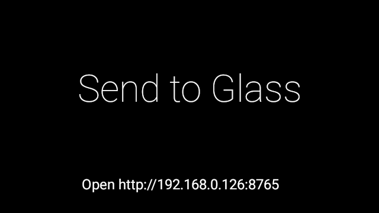 |

| Queue list | Recent list | Favorites list |
| --- | --- | --- |
| 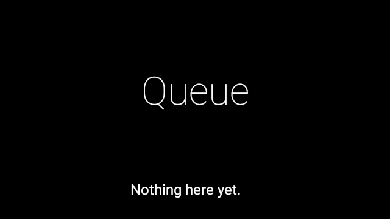 | 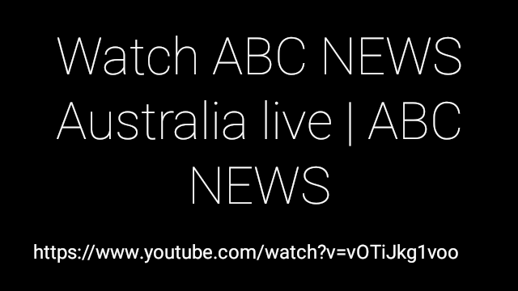 | 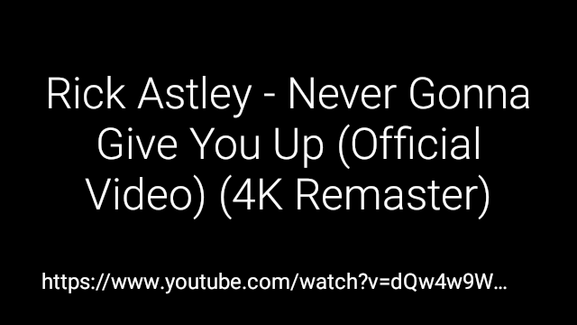 |

Original on-Glass screenshots from the base GlassTube project are retained below to credit and show the upstream Glass-first experience this fork builds on.

| Voice search | Search results |
| --- | --- |
|  |  |

| Link handling | Video playback |
| --- | --- |
|  |  |

### Portrait Remote UI

GlassyTube Remote adds a portrait phone remote served directly from Glass.

| Sleeping / battery-saving state | Active playback remote |
| --- | --- |
| 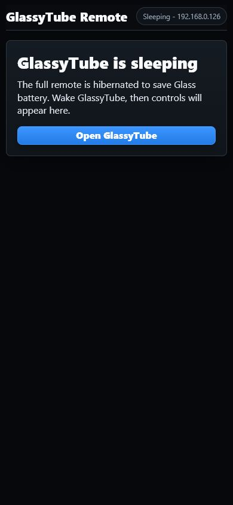 | 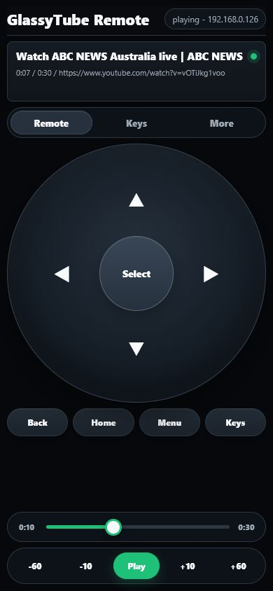 |

| Keyboard / smart input | Volume and actions |
| --- | --- |
| 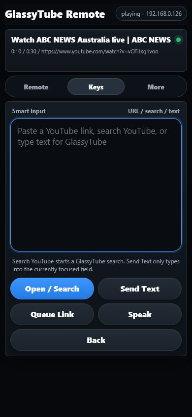 | 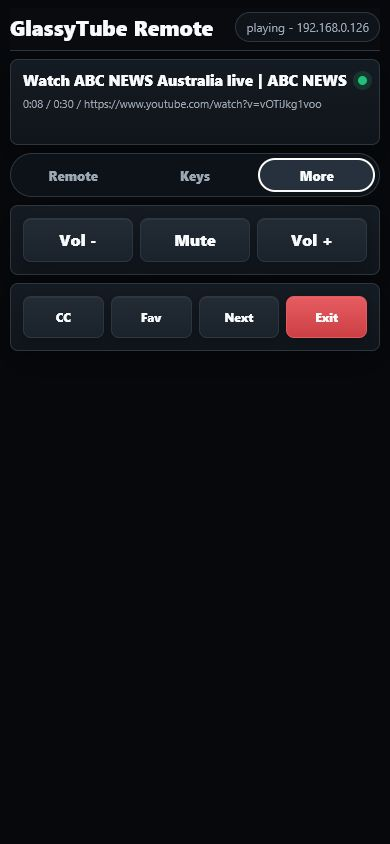 |

## Modules

- `app`
  Main GlassyTube app: Glass cards, YouTube search, URL handling, playback, history, favorites, queue, and Glass gestures.

- `remoteagent`
  Lightweight LAN remote host. It owns `http://<glass-ip>:8765`, serves the remote UI, wakes GlassyTube, sends keyboard/navigation/media commands, and proxies GlassyTube controls.

- `glassagent`
  Separate experimental agent app work area. It is not required for GlassyTube playback or GlassyTube Remote.

- `bridge`
  Experimental local bridge scaffolding for future agent integrations.

## Main Features

### GlassyTube On Glass

- "Ok Glass" video-search entry using the supported Glass `FIND_A_VIDEO` voice command.
- Search results shown as native Glass cards.
- YouTube video, playlist, channel, and shared-link handling.
- Recent videos, favorites, and queue.
- ExoPlayer playback optimized for Glass-friendly streams.
- Live-stream support through HLS where YouTube/NewPipeExtractor exposes a usable stream.
- Clearer loading, empty, unsupported, and error states.

### Glass Gestures

In video playback:

1. Tap: play/pause.
2. Swipe forward/back: seek.
3. Two-finger swipe: larger scrub.
4. Two-finger tap: captions toggle.
5. Long press: favorite/unfavorite.
6. Swipe down: exit playback.
7. Triple tap: enter or dismiss volume mode.
8. In volume mode, swipe forward/back to adjust media volume.

### Phone / PWA Remote

Open this from a phone or computer on the same Wi-Fi:

```text
http://<glass-ip>:8765/remote
```

The remote can:

- Wake GlassyTube when it is sleeping.
- Open a YouTube URL immediately.
- Queue a YouTube URL.
- Play/pause.
- Seek forward/back.
- Scrub the timeline.
- Control captions, favorites, next, and exit.
- Send text/search input to GlassyTube.
- Send basic Glass navigation and media keys.
- Adjust volume.

The remote is designed to behave more like a compact device remote than a normal web page. When GlassyTube is inactive, it shows a sleeping/wake screen and polls slowly to save battery.

## Remote Endpoints

`GET /status`

Returns remote status, GlassyTube activity state, queue count, and current player state. This endpoint is read-only.

`POST /glasstube/wake?token=<token>`

Starts or brings GlassyTube forward.

`POST /glasstube/open?token=<token>`

Body: YouTube URL. Opens immediately.

`POST /glasstube/queue?token=<token>`

Body: YouTube URL. Adds to queue.

`POST /glasstube/control?token=<token>&cmd=<command>`

Supported commands include:

```text
play_pause
play
pause
seek_back
seek_forward
seek_back_60
seek_forward_60
seek_to:<milliseconds>
captions
favorite
next
home
back
exit
volume_up
volume_down
mute
```

`POST /glasstube/text?token=<token>`

Body: search text or a YouTube URL.

`POST /system/key?token=<token>&key=<key>`

Sends a Glass/system key such as `home`, `back`, `enter`, `up`, `down`, `left`, `right`, `menu`, `play_pause`, `volume_up`, or `volume_down`.

`POST /system/text?token=<token>`

Sends text to the focused Glass app.

## Security Model

This project is intended for trusted LAN or phone-hotspot use.

- Remote control is plain HTTP because Glass XE24 / Android 4.4.4 is old and local HTTPS hosting is fragile.
- State-changing endpoints require a pairing token.
- `/status` is read-only.
- Do not expose port `8765` to the public internet.
- Use a trusted Wi-Fi network or personal hotspot.
- Treat the remote as powerful: it can send navigation, media, and text input to Glass.

## iOS Shortcut Flow

The practical "cast-like" workflow is link push, not official Chromecast discovery.

1. Open the remote page on your iPhone:

   ```text
   http://<glass-ip>:8765/remote
   ```

2. Add it to the Home Screen if desired.
3. Create an iOS Shortcut that receives a shared YouTube URL.
4. POST that URL to:

   ```text
   http://<glass-ip>:8765/glasstube/open?token=<token>
   ```

For queueing instead:

```text
http://<glass-ip>:8765/glasstube/queue?token=<token>
```

See [IOS_SHORTCUT.md](IOS_SHORTCUT.md) for the shorter shortcut recipe.

## Build Requirements

- Android Studio or Android SDK installed
- JDK 21
- Android SDK platform/build tools available
- ADB access to Glass
- Google Glass with developer/debugging enabled

The app targets modern build tooling while retaining:

```text
minSdk 19
```

That is required for XE24 / Android 4.4.4.

## Build

From the repository root:

```powershell
$env:JAVA_HOME='C:\Program Files\Android\Android Studio\jbr'
$env:ANDROID_HOME="$env:LOCALAPPDATA\Android\Sdk"
$env:ANDROID_SDK_ROOT=$env:ANDROID_HOME
$env:PATH="$env:JAVA_HOME\bin;$env:ANDROID_HOME\platform-tools;$env:PATH"

.\gradlew.bat :app:assembleDebug :remoteagent:assembleDebug
```

Debug APKs:

```text
app/build/outputs/apk/debug/app-debug.apk
remoteagent/build/outputs/apk/debug/remoteagent-debug.apk
```

## Install

```powershell
adb install -r app\build\outputs\apk\debug\app-debug.apk
adb install -r remoteagent\build\outputs\apk\debug\remoteagent-debug.apk
```

Start GlassyTube Remote:

```powershell
adb shell am start -n com.glass.remoteagent/.MainActivity
```

Find the Glass IP from the remote card on Glass or from:

```powershell
adb shell ip addr show wlan0
```

Then open:

```text
http://<glass-ip>:8765/remote
```

For local testing through USB:

```powershell
adb forward tcp:8765 tcp:8765
```

Then open:

```text
http://127.0.0.1:8765/remote
```

## Verified Device Behavior

Validated on Google Glass Explorer Edition / XE24:

- GlassyTube is registered as the only Glass voice-trigger app from this project.
- GlassyTube Remote does not appear in the Ok Glass voice menu.
- Remote wake opens GlassyTube from the sleeping state.
- Normal video playback selects a muxed 360p stream when available.
- Live HLS playback keeps the master manifest when separate audio exists.
- AAC-LC audio is preferred/forced when available.
- Remote play/pause works.
- Remote timeline position updates while video is playing.
- Remote absolute seek works through `seek_to:<milliseconds>`.
- Exit releases ExoPlayer and returns GlassyTube to idle.
- After exit, Glass reports no app wake locks and no GlassyTube service remains active.
- The only persistent service is the lightweight GlassyTube Remote service used to serve the PWA and wake GlassyTube.

## Known Limitations

- Official YouTube Cast-button support is not implemented. The supported "cast-like" path is sending links over LAN.
- YouTube extractor behavior can change when YouTube changes its site/API behavior.
- Some videos may be unavailable because of region, age, format, DRM, or extractor limitations.
- Old Glass/XE24 logs show many ExoPlayer and OMX compatibility warnings. These are expected on Android 4.4.4 and do not always mean playback failed.
- Android `screencap` can show a black image for hardware video surfaces, so ADB screenshots are not reliable proof of video frame rendering.
- Live streams often expose a rolling DVR window; the reported position may move within a short window rather than behaving like a full-length video timeline.

## Troubleshooting

Check device connection:

```powershell
adb devices
```

Check remote status:

```powershell
curl http://<glass-ip>:8765/status
```

Check through USB forwarding:

```powershell
adb forward tcp:8765 tcp:8765
curl http://127.0.0.1:8765/status
```

Check voice trigger registration:

```powershell
adb shell dumpsys package com.catothecat.glasstube | findstr /i "VOICE_TRIGGER DIRECTORY VoiceTrigger"
adb shell dumpsys package com.glass.remoteagent | findstr /i "VOICE_TRIGGER DIRECTORY VoiceTrigger"
```

Check active services:

```powershell
adb shell dumpsys activity services | findstr /i "GlassyTube RemoteAgent LinkReceiver AgentService"
```

Check wake locks after exiting playback:

```powershell
adb shell dumpsys power | findstr /i "mWakefulness mWakeLockSummary Wake Locks"
```

Useful log filters:

```powershell
adb logcat -d -t 2000 | findstr /i "VideoActivity HLS Audio track Forced AAC Playback error AgentServer"
```

## Development Notes

- Keep Glass UI native to cards and gestures.
- Keep phone/desktop interaction in the remote PWA.
- Do not make GlassyTube itself a persistent always-on web server.
- Keep GlassyTube Remote lightweight so the saved PWA can wake GlassyTube without keeping playback resources alive.
- Prefer Glass-friendly streams: muxed 360p or lower for normal video, HLS master for live streams with separate audio.
- Avoid video-only streams unless an explicit silent-video fallback is added.

## Credits

Thanks to:

- **CatotheCat11** for the original GlassTube project.
- **CatotheCat11/OpenPrism** for Glass compatibility support used by this build.
- **NewPipeExtractor** for YouTube extraction.
- **ExoPlayer** for playback.
- **NanoHTTPD** for the embedded LAN remote server.

GlassyTube exists because the original GlassTube project made YouTube on Glass practical; the added work focuses on making that experience more stable, remote-friendly, and usable on aging Glass hardware.

